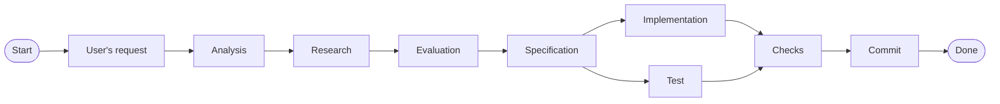

# AGENTS.md

This project is an Electron desktop application for Azure DevOps: `apps/desktop`
(Electron host — main process, preload bridge, native integrations) + `apps/renderer`
(React 19 SPA) in a pnpm workspace, with `packages/shared` holding the contracts
between them. It runs on the Vite+ (`vite-plus` / `vp`) toolchain.

The renderer and the process code are separate packages by design, and the
boundaries between them are machine-enforced (`vp run arch-check`). The
preload bridge (`window.azdo`) is the only channel across that boundary, and Zod
validates every payload on it.

> Note that this project is still a scaffold, so you are allowed to make major
> refactors and changes across the source code — but the architecture boundaries
> and the toolchain decisions are deliberate. Read `README.md` before proposing
> anything that crosses a boundary or replaces a toolchain choice.

## Tooling

### Environment

- `pnpm` is the package manager of this repo (`12.11.2`, pinned via
  `packageManager`; corepack works).
- `vite-plus` (`vp`) is the single toolchain: `vp lint` (Oxlint), `vp fmt`
  (Oxfmt), `vp test` (Vitest), `vp pack` (Rolldown-style bundling), `vp run`
  (task runner) and the git hook dispatcher.
- Use ripgrep (`rg`) instead of normal `grep`.
- All primary commands are `pnpm` scripts at the root plus `vp run` tasks
  declared in `vite.config.ts`.
- Use `zsh`/`bash` as your primary terminal.

### Commands

Run everything through the root `package.json` scripts and `vp run` tasks.
`vite.config.ts` is the single declarative source for format, lint, test,
staged-file and task settings, so it cannot drift from the hooks the way a
Makefile could. `pnpm run` lists the scripts; `vp run` lists the tasks.

Here are the commands you need for your everyday tasks:

| Task                                                  | Command                                    |
| ----------------------------------------------------- | ------------------------------------------ |
| Dev (renderer server + main/preload watch + Electron) | `pnpm dev`                                 |
| Build                                                 | `pnpm build`                               |
| Start the built app                                   | `pnpm start`                               |
| Format + lint + type-aware lint                       | `pnpm check`                               |
| Typecheck every workspace                             | `pnpm typecheck`                           |
| Complexity gate                                       | `pnpm check:complexity` (cognitive max 15) |
| Tests, all workspaces                                 | `pnpm test`                                |
| E2E smoke test                                        | `pnpm test:e2e`                            |
| Package for distribution                              | `pnpm dist`                                |
| Unused files/deps/exports                             | `vp run knip`                              |
| Import-boundary guard                                 | `vp run arch-check`                        |
| Secret scan (push range)                              | `vp run secrets`                           |
| SAST (parked, run by hand)                            | `vp run sast`                              |
| Dependency scan (parked, run by hand)                 | `vp run deps`                              |
| Tests changed since base                              | `vp run tests:changed`                     |
| Full pre-push gate                                    | `vp run push-gate`                         |

Style config lives in `vite.config.ts` — read it, do not restate it. The
`tsconfig.base.json` strictness flags belong to the same category: they are the
canonical copy, `README.md` points here.

Hook policy is declared in `vite.config.ts`, not in script: the `staged` block
drives pre-commit and the `run.tasks` block defines the pre-push gate.
`pnpm install` installs the hooks (`prepare` → `vp config --no-agent`).
`VP_GIT_HOOKS=0 git commit …` bypasses a run.

## Subagent Instructions

Subagents are powerful tools that help you stay focused on the main task by
delegating related supporting tasks to specialized agents. Each subagent can
focus deeply on a specific area, while you concentrate on the primary goal.

When delegating a task to a subagent, give it clear and specific instructions
focused on the smallest meaningful unit of work. If the task is more complex,
break it down into smaller, independent tasks and delegate each one to a
separate subagent. Run subagents in parallel when tasks are independent and
have no shared dependencies.

Fundamentally, all the tasks that can be delegated to subagents can be
categorized into **read-only** operations and **write** operations.

### Read-only subagents

There are no restrictions for delegating subagents for read-only tasks such as:

- Repo exploration
- Research
- Validation
- Critique
- Code review

Research is one of the most critical steps for any given task because it:

- Helps you get up-to-date information that is relevant to the given task.
- Helps you avoid outdated information or misinterpretation that originated from
  your knowledge.
- Educates you on typical antipatterns or loopholes that could misguide your
  task.
- Educates you on what is feasible and practical to implement, keeping you
  truthful to the end user based on facts and evidence.
- Provides you with enough information to communicate better with end users in
  much simpler and easier-to-understand terms.

Research when it can improve the answer:

- Check for current and relevant information (this repo's toolchain — Vite+,
  TypeScript 7, React 19, Zod 4 — moves fast; verify against current docs).
- Consider important perspectives and possible interpretations.
- Prefer verified information from reliable sources.
- Use multiple independent sources.
- Use the findings to give clear and accurate answers.

### Write subagents

Subagents for write operations are heavily restricted to the following use
cases:

- Writing unbiased test cases / test suites.
- Multiple highly surgical non-critical writes.

When you delegate subagents to write test cases / test suites:

- Only provide the user's query / agreed specification and an instruction to
  write tests.
- The tests must cover the change meaningfully — every branch the change
  introduces, in the repo's test placement (`test/` co-located in the
  workspace, Vitest for unit specs, Playwright's `test/e2e/` in
  `apps/desktop` for the smoke test).
- When writing tests of existing source code, only describe the behavior of the
  change. Nothing more, nothing less.

Apart from writing tests, the only write operation allowed by subagents is
highly surgical non-critical writes. When the changes are small, non-critical,
and required across multiple parts of the repo, then use subagents for write
operations.

For example, suppose a core dependency has a new major version with an API,
function, or class that replaces complex manual logic with a simpler
abstraction. Adopting the new version requires changes to multiple parts of the
codebase: `pnpm-workspace.yaml` (the `catalog:` block), source code, and tests.

1. Analyze the codebase and determine all required changes.
2. Identify small, independent changes that can be performed safely in
   parallel.
3. Delegate each change to a separate subagent.
4. For each subagent, specify the files it should modify and the exact change it
   should make.
5. Include verification steps for each subagent's change.
6. Review the subagents' changes after they finish.

Therefore the subagent orchestration can be as follows:

- One subagent updates `pnpm-workspace.yaml` (and any `package.json` references)
  and verifies dependency resolution.
- Another updates the affected source code and runs its relevant tests.
- A third updates the corresponding tests and verifies that they pass.

## Agentic workflow

These are the instructions you must follow while making any kind of changes.
There are two types of changes:

- **Small changes**: changes that are very small and include minor
  modifications such as changing a small config, updating a small part of the
  docs, updating packages, renaming files/components, etc. Sometimes the user
  also hints these changes as small or insignificant.
- **Non-small changes**: all other changes. This includes major refactors, new
  features, and anything touching more than one module. Most of this document
  concerns the management of these changes.

Both types of changes follow the same abstract workflow:

### Common starting steps

These are the common steps that both small and non-small changes must follow:

1. The user's input requirement must be analyzed properly.
2. If the requirements are underspecified or have any conflicts, clear them
   with the user by invoking the grill-me skill.
3. Once requirements are clear, you must perform deep research on the
   specified requirements. The research must be done using valid, verified,
   up-to-date sources.
4. If there are any conflicts with the requirements, invoke the grill-me skill
   and resolve the conflict to reach a common understanding. Explain the
   conflict, the referred sources, and the possible fixes in simpler and
   easier words.

### Small changes workflow

If the given change is small:

1. Follow the steps mentioned in [common starting steps](#common-starting-steps).
2. If you're on the `main` branch, create a new branch from `main`.
3. Instead of generating spec docs, give the spec details directly to the user
   to get them reviewed.
4. Once the user approves the specs, implement the changes.
5. If the spec includes changes in the codebase, subagents must write
   tests for the related changes.
6. Perform the checks and wait until the user reviews the changes.
7. Once the user approves, commit the changes.

### Non-small changes workflow

If the given changes are non-small changes, but more complex changes, then
follow the below steps:

1. Follow the steps mentioned in [common starting steps](#common-starting-steps).
2. If you're on the `main` branch, create a new branch from `main`.
3. Based on the user's requirement and research details, draft a specification
   file at `docs/specs/<user-requirement>_<date-timestamp>.spec.md`.
4. Once the user approves it, plan the changes into individual smaller modular
   changes.
5. Each change must have its own relevant tests, generated from the spec file.
6. Once a single change passes all checks including its tests, commit it.
7. Only once that single change is committed successfully can you proceed to
   the next change.
8. Repeat the process of {specs → single change → test & implementation created
   in parallel → all checks pass → commit} for all small individual changes.
9. Once everything is done, let the user review the changes.

What "all checks pass" means for a commit: `pnpm check`, `pnpm typecheck`,
`pnpm check:complexity`, `vp run arch-check`, and the tests for every affected
workspace. The pre-commit and pre-push hooks rerun these over the staged range
automatically — but never rely on the hook as your first signal; a hook failure
is a failed commit, not a test result.

Additional instructions:

- Timestamp string format should be `%Y%m%d_%H%M%S`.
- Use subagents to generate tests relevant to the change based on the spec.
- Generate relevant unit/integration/e2e tests based on the user's requirement.
  In this repo: Vitest specs co-located in each workspace's `test/`, and
  Playwright specs in `apps/desktop/test/e2e/`.
- Prefer creating tests before changes.
- Config-only changes are not exempt from tests. Add an assertion that the
  configuration encodes the decision it exists for, and that fails if the
  decision is reverted (the hook-policy checks in `scripts/hooks/policy.test.ts`
  are the reference example of this shape).

Two failure modes to name explicitly in a PR description, because both survive
review unnoticed:

- **Taxidermy tests.** Well-formed tests that assert nothing. A test that only
  proves "the code runs" passes whether or not the behavior is correct. Every
  assertion must be _able_ to fail: break the thing it covers, watch it go red,
  restore it, and report the evidence you saw.
- **Symptom patches.** Making a consumer tolerate bad data instead of fixing the
  producer. If a value is wrong at a boundary, fix it at the boundary.

A subagent that reports "tests pass" without mutation evidence has not finished
the task. Ask for the red-then-green transcript.

## Codebase rules

These are enforced by tooling, not convention — read them as gates, not
suggestions:

- **Architecture boundaries** (`vp run arch-check`): `packages/` never imports
  from `apps/`; the renderer never imports `electron`; process code (`main` /
  `preload`) never imports React. Cross-boundary traffic goes through
  `packages/shared` and the preload bridge.
- **Errors are values, not exceptions**, outside true boundary failures: probes
  and capabilities return `CapabilityResult` (`{ ok, detail }`) — never throw
  across the bridge. Native modules are lazy-imported inside the functions that
  use them, so a missing platform prebuild cannot kill the main process.
- **Zod 4 validates at the IPC boundary** (`packages/shared` schemas). The
  renderer cannot persist junk, and `ipcMain` handlers parse before writing.
- **No debug statements in application code.** `console.log` / `debug` / `trace`
  / `dir` / `time*`, `debugger`, focused or skipped tests are all blocked on
  staged lines by `scripts/hooks/policy.ts`. Intentional output uses
  `console.warn` / `error` / `info`, or a single-line opt-out via
  `// debug-statements: allow`.
- **Effect 4 lives in the main process only** (`effect`, t3code-style). It never
  crosses the bridge (`arch-check` rejects any `effect*` specifier under
  `packages/`, `apps/renderer/` and `preload/`). Every `ipcMain` handler still
  ends in one `runPromise` that returns a plain serializable value and every
  bridge return type stays `structuredClone`-safe (asserted in
  `packages/shared/test/ipc.test.ts`). When writing Effect, read the version
  that is pinned, not the web: `node_modules/effect/AGENTS.md` and
  `node_modules/effect/ai-docs/` — never `effect.website`, whose nav still
  lists legacy pages. `tsconfig.base.json` enforces the Effect rules via
  `tsc-rs` (see "Strict TypeScript" below), so an unstable or experimental
  module import fails `pnpm typecheck`.
- **Strict TypeScript, maximum settings** (`tsconfig.base.json`). Use
  `interface`, not `type`, for object shapes; `import type` / verbatim syntax is
  enforced; bracket-notation access for index signatures
  (`process.env["ADO_RENDERER_URL"]`); no `any`. Floating promises are
  neutralized with `void`.
- **Naming**: kebab-case files, camelCase functions and variables, PascalCase
  types and schemas, UPPER_SNAKE_CASE for frozen constants. Node builtins use
  the `node:` protocol.
- **Version bumps happen in exactly one place** — the `catalog:` block of
  `pnpm-workspace.yaml`. Never pin a literal version that exists in the catalog.
- **Do not restructure `vite.config.ts` into an `.oxlintrc.json` or a Makefile.**
  Oxlint resolves config from the nearest `vite.config.*` with a `lint` block, so
  a partial second config silently shadows the whole ruleset. `.oxlintrc.complexity.json`
  is the one deliberate exception: an isolated `vp lint -c` gate with its own
  rule set.

## Additional Instructions

- [Commit Instructions](.agents/instructions/commit.instruction.md)
- **Branching**: never commit directly to `main` — pre-commit refuses it
  (override once with `ALLOW_MAIN=1` only if the user explicitly asks). Branch
  from `main` for every task.
- **Architecture rationale, packaging, and known follow-ups** live in
  `README.md`. When a change touches any of those areas, consult it first —
  this file governs _how_ you work, that one governs _why the repo is shaped
  this way_.
